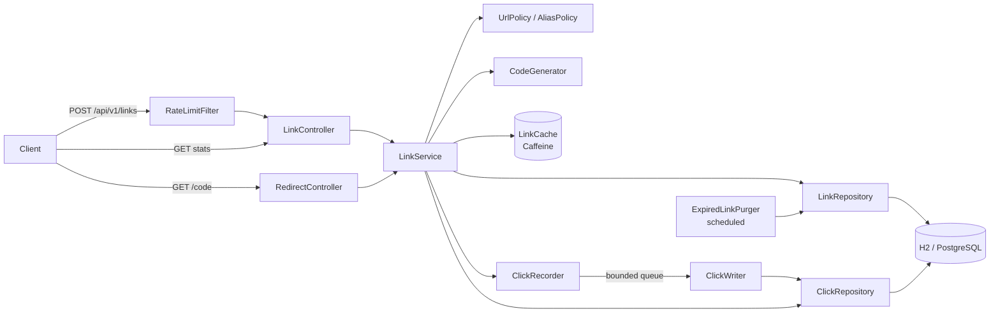
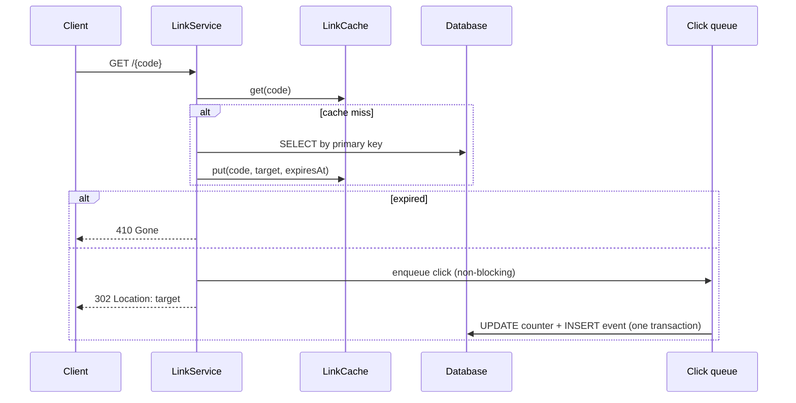
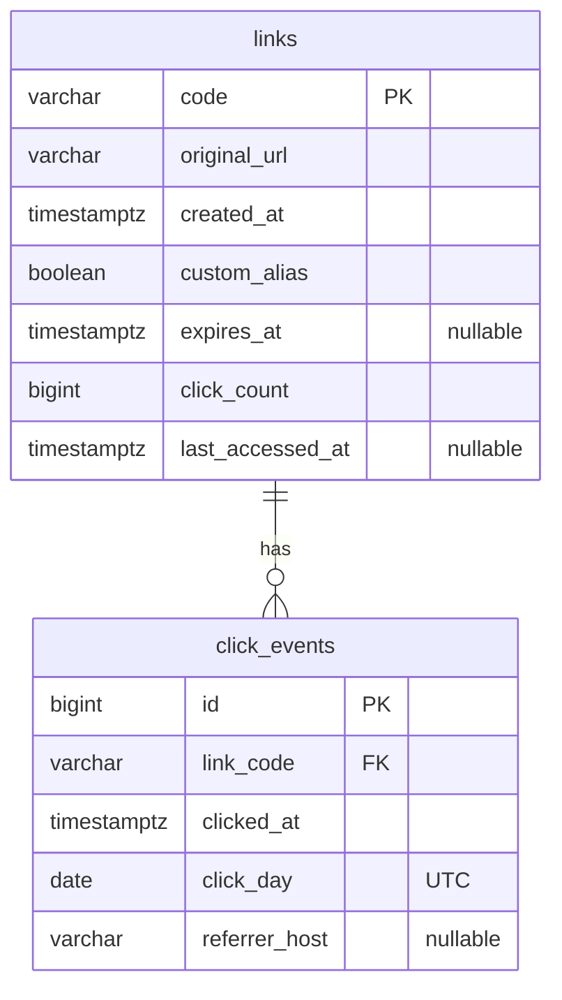

# Architecture

## Components

| Layer | Package | Responsibility | Depends on |
| --- | --- | --- | --- |
| Web | `web` | HTTP mapping, input validation, error format, rate limiting | service, domain |
| Service | `service` | Use cases, caching, async click recording, purge | persistence, domain |
| Persistence | `persistence` | SQL statements | domain |
| Domain | `domain` | Rules and algorithms with no framework dependency | nothing |
| Config | `config` | Typed settings, wiring | domain |

Dependencies point inward. The domain package imports nothing from Spring, which
is why its tests run in milliseconds with no application context.

## Tools

| Concern | Choice |
| --- | --- |
| Language and framework | Java 17+, Spring Boot 3.3 (Web MVC) |
| Data access | Spring `NamedParameterJdbcTemplate`, hand-written SQL |
| Schema | Flyway migrations |
| Database | H2 (local and tests), PostgreSQL (profile `postgres`) |
| Cache | Caffeine, in-process |
| API docs | springdoc-openapi (generated) and `docs/openapi.yaml` (reviewed contract) |
| Tests | JUnit 5, Spring MockMvc |
| CI | GitHub Actions running `mvn verify`; Dependabot for dependency updates |

## Control flow

### Create a link

1. `RateLimitFilter` takes one token from the caller's bucket, or answers 429 with `Retry-After`.
2. Bean Validation checks the request shape (`url` present, `ttlSeconds` in range).
3. `UrlPolicy` checks the destination; `AliasPolicy` checks the alias if one was sent.
4. `LinkService` inserts the row. With a generated code it retries on a primary-key
   collision (up to 5 times). With an alias a collision is a 409.
5. Response: 201 with the short URL.

### Redirect

### Read analytics

`totalClicks` and `lastAccessedAt` come from the `links` row. Per-day counts and
top referrers are aggregated from `click_events` using the `(link_code, click_day)` index.

## Data model

The short code is the primary key. The redirect is therefore a single
primary-key lookup, and the database is the only authority on uniqueness.

## Key decisions

| # | Decision | Alternatives considered | Why |
| --- | --- | --- | --- |
| 1 | Random base62 codes, 7 characters | Base62 of a sequence; hash of the URL | Sequential codes let anyone enumerate every link. A hash makes the same URL always map to one code, which would merge different users' analytics. 62^7 is about 3.5 trillion codes, so collisions are rare and a retry handles them. |
| 2 | Uniqueness by insert-and-catch on the primary key | Check, then insert | Check-then-insert has a race between two instances. The constraint cannot be raced. |
| 3 | 302 with `Cache-Control: no-store` | 301 permanent redirect | Browsers cache a 301, so repeat visits would bypass the service and never be counted. Costs one extra round trip per visit. |
| 4 | Clicks recorded asynchronously through a bounded queue; drop when full | Synchronous write; unbounded queue; message broker | A redirect must not slow down or fail because of analytics. An unbounded queue turns a slow database into an out-of-memory crash. The cost is that counts are eventually consistent and can under-count under overload or on a crash. A broker is the production answer and is out of scope here. |
| 5 | Counter column plus append-only event log | Count events on every read | The counter makes the common "how many clicks" read O(1). It is incremented in SQL (`click_count = click_count + 1`) in the same transaction as the event insert, so the two cannot drift and concurrent clicks cannot lose updates. |
| 6 | In-process Caffeine cache, positive entries only | Redis; cache misses too | Destinations are immutable, so entries never go stale. Caching misses would hide a link just created on another instance. Redis adds an operational dependency this prototype does not need. |
| 7 | Plain SQL through JdbcTemplate | JPA / Hibernate | Two tables and six statements. Every query the service runs is visible in two small classes, and the atomic increment and aggregations would be native queries under JPA anyway. |
| 8 | Store only the referrer host | Full referrer, IP, user agent | Enough for "where does traffic come from" without holding personal data. |
| 9 | Rate limit creation only, keyed by remote address | Limit everything; trust `X-Forwarded-For` | Creation is the write path that can be abused. `X-Forwarded-For` is client-controlled unless the platform is configured to trust a known proxy. |
| 10 | Aliases share the code namespace | Separate alias table | One lookup path and one uniqueness rule. See [scenario 2](scenarios/02-brownfield.md). |
| 11 | Per-link TTL, 410 after expiry, purge after 30 days | Hard delete at expiry; global retention | See [scenario 3](scenarios/03-ambiguous.md). |
| 12 | No delete or update endpoint | Unauthenticated DELETE | Without authentication anyone could delete anyone's link. Left out deliberately until ownership exists. |

## Scaling path

The service is stateless apart from the cache and rate-limit buckets, so it can
run as several instances behind a load balancer today, with two caveats that are
listed as limitations: the rate limit becomes per instance, and every instance
runs the purge job (harmless, because it is idempotent).

Next steps as load grows, in order: PostgreSQL with a read replica for
analytics, a shared rate limiter (Redis), click events through a broker
(Kafka) into an analytics store, partitioning `click_events` by month, and a CDN
or edge cache in front of redirects if analytics can move to edge logs.
