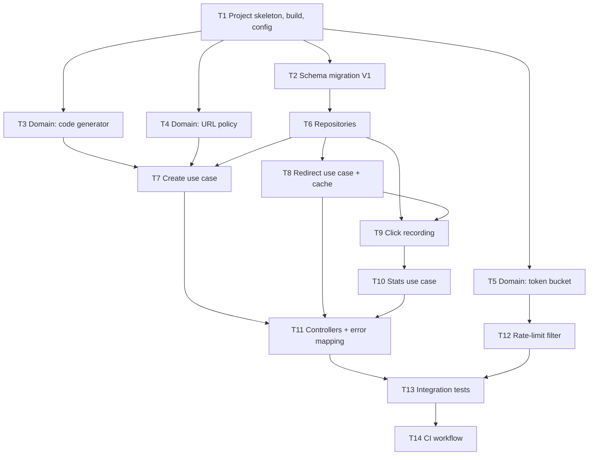

# Scenario 1: Greenfield

**Requirement as given:** "Build a URL shortener service from scratch with core
APIs, analytics, and reliability features."

Commit: `feat: URL shortener core (greenfield)`

## 1. Requirement understanding

The brief names three areas and leaves the content of each open. They were
normalized into this problem statement:

| Area | Interpreted as | Out of scope (stated, not forgotten) |
| --- | --- | --- |
| Core APIs | Create a short link; redirect; read link metadata | Update, delete, user accounts |
| Analytics | Total clicks, clicks per day, top referrers, last access | Geography, device, unique visitors |
| Reliability | Input validation, collision-safe codes, rate limiting, caching, analytics that cannot break redirects, consistent errors, health check, versioned schema | Multi-region, high availability of the database |

Ambiguities found and how each was resolved:

| Question | Decision | Reason |
| --- | --- | --- |
| Same URL submitted twice: same code or new code? | New code each time | With no user accounts, sharing a code would mix different callers' analytics |
| 301 or 302? | 302, no-store | A cached 301 hides repeat visits from analytics |
| Must click counts be exact? | No, eventually consistent | Redirect latency and availability matter more than an exact count |
| Which URLs are allowed? | Public http/https only | A shortener that accepts `javascript:` or internal addresses is an abuse tool |
| Who may read stats? | Anyone with the code | No identity model in scope; recorded as a limitation |

## 2. Task decomposition

Each task was defined with intent, constraints and acceptance criteria before
any code was written. Three examples:

| Task | Intent | Constraints | Acceptance criteria |
| --- | --- | --- | --- |
| T3 Code generator | Unguessable, URL-safe codes | No framework imports; randomness injectable for tests | Fixed length; base62 only; deterministic for a seeded source; rejects invalid lengths |
| T7 Create | Persist a link under a unique code | Correct with several instances; no check-then-insert | Collision retried up to N times; clear error when the budget is exhausted |
| T9 Click recording | Count every redirect | Must never slow or fail a redirect; bounded memory | Counter and event written in one transaction; full queue drops and counts the drop; write failure is logged, not thrown |

## 3. Execution

Built bottom-up in the order of the graph: domain classes first (they have no
dependencies and are the easiest to verify), then SQL, then use cases, then HTTP.

Points where the first approach was changed during the build:

- **Numeric key dropped.** The first schema design had a numeric `id` plus a unique
  `code`. The code became the primary key instead: the hot path is a lookup by
  code, and it removed the need to read back generated keys, which behaves
  differently across database drivers.
- **Timestamps bound as `java.sql.Timestamp`.** Binding `Instant` directly works
  on H2 but is not supported by the PostgreSQL driver. The portable form was used
  so the same code runs on both.
- **Per-day aggregation.** Grouping by `CAST(clicked_at AS DATE)` depends on the
  database session time zone. A `click_day` column computed in UTC by the
  application replaced it, which also gives the index its second column.
- **DELETE endpoint removed.** It was in the first API sketch. Without
  authentication it would let anyone delete any link, so it was cut.
- **Numeric host bypass.** Review of the URL policy found that
  `http://2130706433/` (decimal for 127.0.0.1) would pass a dotted-quad check.
  A rule and tests for numeric-only hosts were added.

## 4. Validation

| What | How |
| --- | --- |
| Code generator, URL policy, rate limiter, referrer parsing | Unit tests with no Spring context; the rate limiter uses a fake clock, so no sleeps |
| Create, redirect, metadata, stats, validation errors, 404 | MockMvc integration tests against the real application and migrated H2 |
| Rate limit | Integration test with a 3-token bucket: 4th request is 429 with `Retry-After`; another client and read endpoints are unaffected |
| Schema | Flyway applies V1 at test start; the tests fail if DDL and SQL disagree |

Risks specific to this stage are in the [engineering summary](../ENGINEERING_SUMMARY.md#risks-and-trade-offs).
