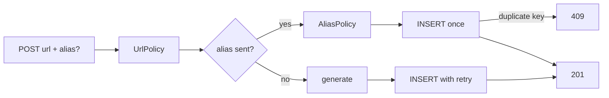

# Scenario 2: Brownfield

**Requirement:** "Let callers choose their own short code (a custom alias),
for example `/spring-sale`, without breaking existing links or clients."

Commit: `feat: custom aliases (brownfield enhancement)` (diff it against the
greenfield commit to see exactly what changed).

## 1. Requirement understanding

| Question | Decision |
| --- | --- |
| Is the alias optional? | Yes. Existing clients send only `url` and must see no change. |
| What characters and length? | 4 to 32 of `A-Z a-z 0-9 - _`. These are URL-safe without encoding and already accepted by the redirect route. |
| Case-sensitive? | Yes, the same as generated codes. Making only aliases case-insensitive would need a second lookup rule. Recorded as a look-alike risk. |
| Alias already taken? | 409 Conflict. Never silently fall back to a random code: the caller asked for a specific address. |
| Any alias allowed? | No. Words that are or could become application paths are reserved (`actuator`, `swagger-ui`, `admin`, ...). |

## 2. Codebase reasoning: what the change touches

The existing design was read before changing anything. Findings:

| Area | Existing behaviour | Impact |
| --- | --- | --- |
| `links.code` primary key, `VARCHAR(32)` | Holds generated 7-character codes | Aliases fit in the same column. **Decision: one namespace**, so redirect, cache and analytics need no change. |
| `RedirectController` route `/{code:[A-Za-z0-9_-]+}` | Matches generated codes | Already matches the alias character set. Verified by a new integration test instead of assumed. |
| `LinkService.create` | Generates a code, retries on collision | Needs a second path: with an alias there is nothing to retry. Split into two private methods so the generated path stays as it was. |
| Generated-code collisions | Could only collide with other generated codes | Can now collide with an alias that happens to look like a code. Already handled by the same retry; comment updated. |
| `CreateLinkRequest`, `LinkResponse` | `url` only | Additive fields only (`alias` in, `customAlias` out). No existing field changes meaning. |
| `ApiExceptionHandler` | Maps domain errors | Two new mappings: 400 invalid alias, 409 alias unavailable. |
| Schema | V1 | New column `custom_alias`. Additive with a default, so the previous application version still runs against the new schema (safe rolling deploy and rollback). |
| Rate limiting, caching, click recording | Keyed by code | Unaffected. |

Data flow after the change:

## 3. Task decomposition

| # | Task | Depends on |
| --- | --- | --- |
| B1 | `AliasPolicy` (format, reserved words) with unit tests | none |
| B2 | Migration V2: `custom_alias` column | none |
| B3 | Repository: write and read the new column | B2 |
| B4 | Service: alias path, 409 on conflict | B1, B3 |
| B5 | API: request and response fields, error mappings | B4 |
| B6 | Integration tests, including regression of the no-alias path | B5 |

## 4. Execution notes

- **No pre-check for availability.** "SELECT to see if the alias exists, then
  INSERT" was considered and rejected. It has a race: two requests can both pass
  the check. The insert itself is the check, exactly as for generated codes.
- **Validation lives in one place.** The alias format could have been a
  `@Pattern` annotation on the request and a second check for reserved words in
  the service. Both rules were put in `AliasPolicy` so they cannot drift apart
  and can be unit tested together.
- **Blank alias means no alias.** Form clients often send `""` for an empty
  field. Treating it as an error would be a needless breaking edge.

## 5. Validation

| Risk | Test |
| --- | --- |
| Existing clients break | All greenfield integration tests still run unchanged; `generatedCodesAreNotFlaggedAsCustom` |
| Alias does not redirect | `createsALinkWithACustomAlias` creates and follows an alias containing `-` and `_` |
| Duplicate alias overwrites a link | `rejectsAnAliasThatIsAlreadyTaken` asserts 409 and that the first link still resolves to its own URL |
| Bad or reserved alias accepted | `AliasPolicyTest` (boundaries 3/4/32/33 characters, spaces, slashes, dots, non-ASCII, reserved words in any case) and `rejectsMalformedAndReservedAliases` |
| Migration breaks existing rows | V2 is additive with a default; Flyway applies V1 then V2 in every test run |

## 6. Rollout and rollback

1. Apply V2 (additive, safe with the old version running).
2. Deploy the new version.
3. Rollback is a redeploy of the old version; the extra column is ignored. Links
   created with aliases keep working because they are ordinary rows.
